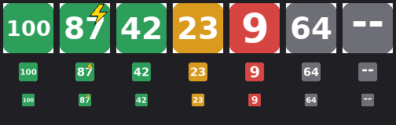
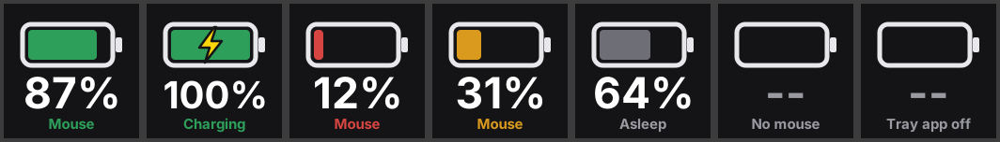

# ATK A9 Air Plus Battery

Battery level for **ATK A9-family wireless mice** in the Windows tray, a polling-rate switcher one click away, and an optional **Stream Deck** key showing the level. You don't need ATK HUB open.

<p>
  <br>
  
</p>

> **Status: early.** Built for the **ATK A9 Air Plus** and currently being verified on one. Other A9-family mice that use the same protocol should work. If yours doesn't, please [open a device-support issue](../../issues/new?template=device-support.yml) with your diagnostics file.

## Features

- **Tray icon showing the battery %.** It's green above 35%, amber at 35% and below, and red at 15% and below. It goes grey while the mouse sleeps (keeping the last reading), and a yellow bolt means it's charging.
- **Click the icon for the menu.** The polling rate goes from 125 Hz to 8 kHz, and each change is read back from the mouse to confirm it took.
- **Low-battery alert.** One notification when the level reaches 15%. The threshold can be changed.
- **Stream Deck key, battery only.** It updates every 15 seconds.
- **Start with Windows** option, **diagnostics** dump and optional debug logging.

## Install

1. Download `ATK Battery.exe` from the [latest release](../../releases/latest).
2. Put it somewhere permanent, e.g. `%LOCALAPPDATA%\ATKBattery\`, and run it.
   Windows SmartScreen may warn because the exe isn't code-signed. Choose **More info → Run anyway**.
3. Click the tray icon and tick **Start with Windows**.

**Keep the icon visible** rather than hidden behind the `^` arrow. Go to *Settings → Personalization → Taskbar → Other system tray icons* and switch **ATK Battery** on. Windows remembers this per exe location, so keep the exe in one place.

**Close ATK HUB while the app runs**, so the two aren't sending commands to the mouse at the same time.

### Stream Deck (optional)

1. Download `com.jb.atk-battery.streamDeckPlugin` from the same release and double-click it. You need Stream Deck 7.1 or later.
2. Drag **ATK Mouse Battery → Mouse Battery** onto a key.

The key reads the level from the tray app. It shows *Tray app off* if the tray app isn't running.

## Supported mice

| Mouse | Status |
|---|---|
| ATK A9 Air Plus | Being verified |
| Other ATK A9-family mice (16-byte report-0x08 protocol) | Expected to work, unconfirmed |
| Newer "BITMOUSE" models (ATK ZERO, A9 NK, some A9 Air + receivers on usage page `0xFF05`) | Not supported yet |

## Troubleshooting

- **Icon shows `--` or stays grey.** Move the mouse to wake it. If nothing changes, use **Run diagnostics** in the tray menu and attach `diagnostics.txt` to an issue.
- **A polling rate isn't accepted.** Rates above 1 kHz need ATK's 4K or 8K receiver.
- **Where are the files?** Settings, log and diagnostics are in `%LOCALAPPDATA%\ATKBattery\`. Use **Open log folder** in the tray menu to get there.

`settings.json` options:

| Key | Default | Meaning |
|---|---|---|
| `poll_seconds` | 60 | How often to read the battery while the mouse is awake |
| `asleep_retry_seconds` | 15 | Retry interval while it isn't answering |
| `low_battery_alert` | 15 | Alert threshold in %, `0` to disable |
| `port` | 47231 | Local status port; the Stream Deck plugin expects 47231 |
| `debug` | false | Log every raw HID frame |

## How it works

The mouse's receiver exposes a vendor HID collection that accepts 16-byte commands on report `0x08`, each with a `0x55` checksum:

- command `0x04` returns the battery %, a charging flag and the voltage;
- EEPROM address `0x0000` holds the polling rate.

The app opens a fresh HID handle for every request. Windows queues input reports per handle, so a handle kept open long-term ends up reading stale replies.

The Stream Deck plugin never talks to the mouse. It reads `GET http://127.0.0.1:47231/status` from the tray app. That endpoint:

- listens on loopback only;
- is read-only;
- rejects requests whose `Host` header isn't `127.0.0.1`/`localhost`, so a web page can't read it through DNS rebinding.

Polling-rate changes are only possible from the tray menu.

## Build from source

You need Windows, Python 3.10 to 3.14, and Node 20 or later for the plugin.

```bat
cd tray
build.bat                      :: makes tray\dist\ATK Battery.exe
python -m pytest tests         :: offline tests, no mouse needed

cd ..\streamdeck
npm ci
npm run pack                   :: makes streamdeck\dist\*.streamDeckPlugin
```

Pushing a `v*` tag builds both on GitHub Actions and attaches them to a release.

## Credits

The protocol details come from two open-source projects:

- [OpenMouse-Project/mouse-protocol](https://github.com/OpenMouse-Project/mouse-protocol) (AGPL-3.0): the ATK command set, polling-rate codes, device table and the A9 Plus capture used in the tests.
- [HeyOkay/HaloBattery](https://github.com/HeyOkay/HaloBattery) (MIT): Windows HID handling for ATK/Pulsar mice and sleep behaviour.

## Licence

[GPL-3.0](LICENSE). This project is not affiliated with or endorsed by ATK. "ATK" and model names belong to their owners.
